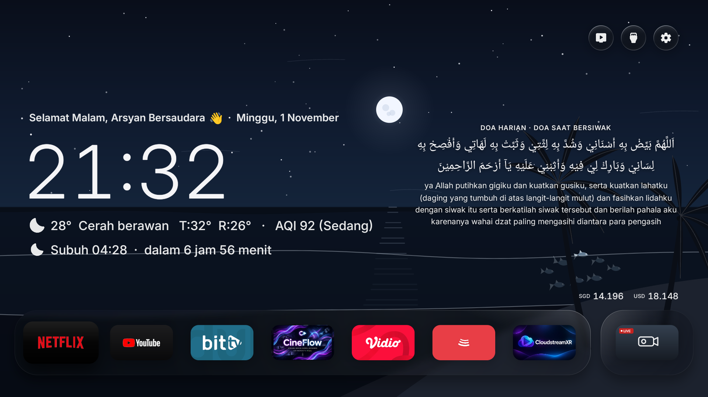
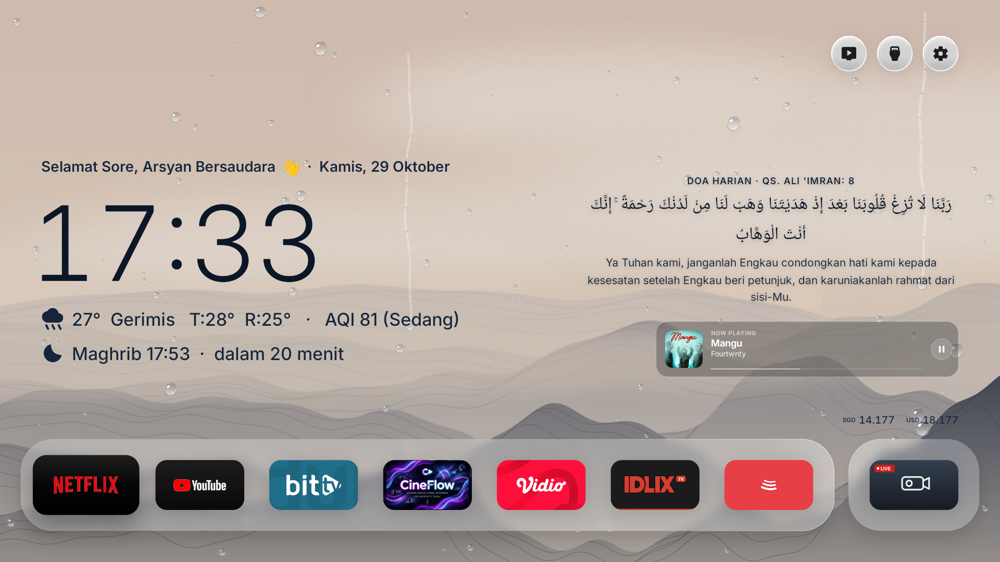
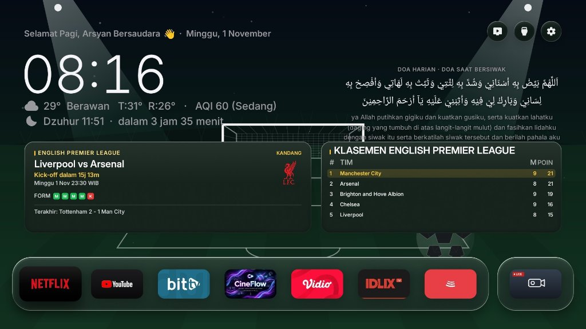
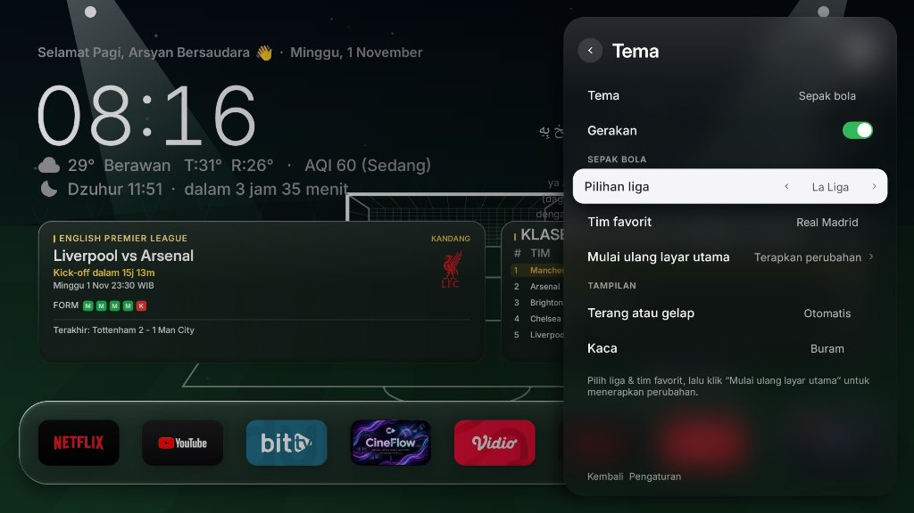
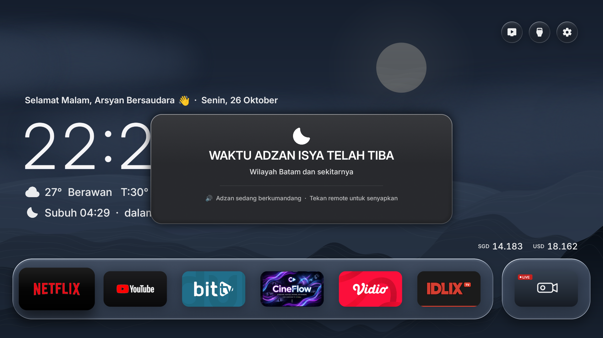
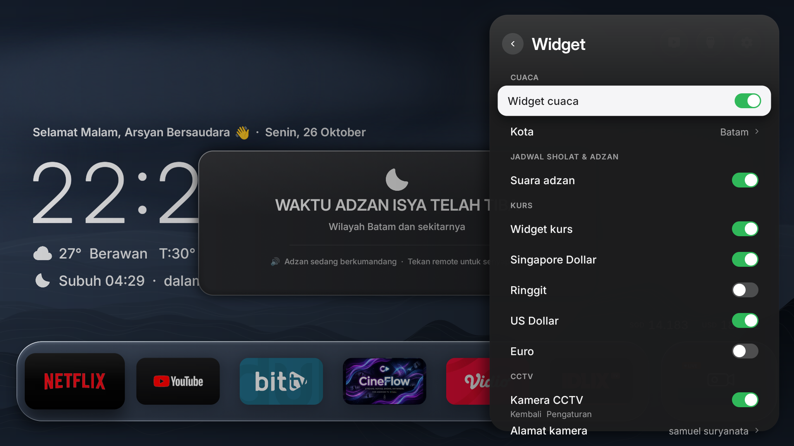

# Arsyan TV Launcher v2.8

[](https://github.com/ssemyy-sds/arsyan-tv-launcher)

<p align="center">
  <b>Bahasa</b> · <a href="README_EN.md">English</a> · <a href="README_MS.md">Malay</a>
</p>

Peluncur (*Launcher*) Android TV yang bersih, modern, dan estetik terinspirasi dari filosofi desain Nothing OS dan Apple TV. Dibangun secara native untuk perangkat Android TV dan Google TV dengan sentuhan *glassmorphism* lembut, tipografi elegan, cuaca dinamis waktu nyata, Indeks Kualitas Udara (AQI), kurs mata uang, doa harian dan ayat Al-Qur'an dinamis, **Tema Sepak Bola Hidup (Jadwal Pertandingan & Klasemen Liga)**, **Overlay Musik Now Playing (BitChord / Spotify / YouTube Music)**, **Pembaruan Sistem Nirkabel (OTA)** langsung dari GitHub Releases, serta notifikasi Adzan otomatis. Terkonfigurasi awal untuk Kota Batam dengan dukungan penuh untuk seluruh kota di Indonesia maupun mancanegara.

---

## 📺 Showcase

### 1. Wallpaper Vektor Dinamis "Ocean & Coast" (Tema Pantai & Laut Lepas)
Pengganti total live wallpaper pegunungan dengan tema pesisir pantai vektor murni (*Android Canvas*). Menampilkan cakrawala laut lepas, 3 lapisan ombak bergulung lembut (60 FPS), pohon kelapa yang tertambat tenang ditiup angin pantai, serta kawanan 8 ekor ikan vektor interaktif yang berenang merespons tombol remote D-Pad TV. Posisi Matahari dan Bulan terbit dan terbenam secara presisi ke dalam garis cakrawala laut mengikuti waktu jam lokal nyata dengan zona aman bebas tabrakan teks.



---

### 2. Tampilan Beranda Minimalis dengan Widget Now Playing
Tata letak tipografi bersih untuk jam, cuaca waktu nyata, indeks AQI, hitung mundur waktu sholat, dan Doa Harian. Ketika musik sedang diputar dari **BitChord** atau pemutar media lainnya, kartu kaca buram (*frosted-glass*) **Now Playing** akan muncul secara mulus di sisi kanan atas baris kurs mata uang, lengkap dengan sampul album, judul lagu, musisi, bilah progres, dan status putar/jeda.



---

### 3. Tema Sepak Bola & Widget Pertandingan Langsung
Dukungan wallpaper tema sepak bola dengan latar lapangan bertekstur rumput hidup dan pencahayaan lampu stadion (*stadium floodlights*). Menampilkan kartu pertandingan terkini untuk tim favorit lengkap dengan hitung mundur kick-off, logo klub, status kandang/tandang, catatan 5 laga terakhir, serta tabel klasemen top liga secara langsung.



---

### 4. Pengaturan Pilihan Liga & Tim Favorit
Pilihan tema wallpaper Sepak Bola yang fleksibel langsung dari menu Pengaturan TV. Bebas memilih liga top dunia (Premier League, La Liga, Serie A, Bundesliga, Liga 1 Indonesia, UEFA Champions League) beserta klub favorit Anda hanya dengan tombol remote TV.



---

### 5. Notifikasi Adzan Terpusat (~50% Layar)
Modal kartu kaca gelap elegan berukuran proporsional (~50% lebar layar) yang tampil di tengah layar saat waktu sholat tiba, disertai lantunan audio Adzan lengkap yang dapat diheningkan seketika menggunakan tombol remote apapun.



---

### 6. Pengaturan Widget & Suara Adzan
Pengaturan fleksibel untuk mengaktifkan atau menonaktifkan suara Adzan langsung melalui Pengaturan TV maupun di dalam area drawer widget.



---

## ✨ Fitur Unggulan

- **Live Wallpaper "Ocean & Coast" & Siklus Astronomis Dinamis (Pure Canvas 60 FPS)**:
  - **Murni Vektor Programatik**: Seluruh elemen visual (langit, laut lepas, bintang malam, pohon kelapa, ombak, hujan, ikan) digambar murni menggunakan metode Canvas Android (`Path`, `Paint`, `LinearGradient`, `RadialGradient`) tanpa aset gambar PNG/JPG eksternal, menghasilkan performa ultra-ringan 60 FPS stabil tanpa membebani RAM/CPU TV.
  - **Siklus 24 Jam Matahari & Bulan (Real-Time Astronomical Trajectory)**:
    - Posisi benda langit tidak diam atau statis, melainkan bergerak melengkung naik dan turun secara matematis (`Math.sin(prog * Math.PI)`) mengikuti waktu jam lokal TV.
    - **Siklus Siang (Matahari: 05:00 - 19:12)**: Terbit di cakrawala laut saat fajar (05:00), mencapai titik zenit langit pada tengah hari (12:00), dan tenggelam ke batas laut saat senja (19:12) memancarkan jalur kilau keemasan (*golden reflection corridor*).
    - **Siklus Malam (Bulan: 19:12 - 05:00)**: Terbit saat awal malam (19:12), mencapai puncak langit pada tengah malam (00:06), dan tenggelam menjelang subuh (05:00) memancarkan jalur pantulan perak bercahaya ke permukaan laut.
    - **Zona Aman Bebas Tabrakan Teks (Text Anti-Overlap Safe Zone)**: Garis edar horizontal benda langit dikunci secara astronomis pada area tengah dan tengah-kanan langit (X = 50% sampai 70% lebar layar). Area kiri (X < 46%) yang memuat teks ucapan, tanggal hari, jam besar, dan informasi cuaca/sholat selalu bebas dari objek langit dan memiliki kontras gelap yang jernih.
  - **4 Fase Warna Langit & Laut Dinamis**:
    - **Fajar / Sunrise (05:00 - 07:00)**: Gradasi langit merah muda lembut dan pantulan pagi di air laut.
    - **Siang / Daylight (07:00 - 16:00)**: Langit biru toska cerah dengan laut biru jernih tropis.
    - **Senja / Golden Sunset (16:00 - 19:12)**: Gradasi langit amber, oranye hangat, dan ungu senja.
    - **Malam / Starry Night (19:12 - 05:00)**: Langit biru malam berbintang (72 bintang vektor acak stabil) dengan bulan kawah bercahaya.
  - **Overlay Cuaca Hujan & Badai (Weather Reactive)**: Warna langit dan laut otomatis terdesaturasi menjadi abu-abu kebiruan saat cuaca hujan, ombak beriak lebih kencang (*choppy waves*), disertai partikel hujan kristal luminous 2 lapis (*dual-layer depth*).
  - **Kawanan Ikan Interaktif (School of Fish dengan Fisika 3D Yaw)**:
    - 8 ekor ikan vektor berenang anggun di kedalaman laut dengan animasi kibasan ekor alami (*harmonic tail wagging*).
    - **Respons D-Pad Remote TV**: Ketika tombol Panah Kiri/Kanan/Atas/Bawah ditekan, kawanan ikan berbelok mengikuti arah navigasi.
    - **3D Perspective Yaw Turn**: Saat berbalik arah berlawanan, ikan tidak berputar kaku seperti mobil putar balik, melainkan melakukan putaran lateral 3D (lebar tubuh menyempit dan membalik halus) dengan reaksi berantai (*cascading delay*) dari ikan pemimpin ke pengikut.
- **Fitur Donasi "Traktir Kopi" (Dukungan Developer)**:
  - Tombol khusus di menu **Pengaturan -> Tentang** (*Settings -> About*) tepat di bawah tombol OTA.
  - Menampilkan popup dialog modal elegan berisi QR code statis dan pesan terima kasih hangat dari developer untuk traktir kopi dengan dukungan navigasi remote TV yang mudah ditutup.
- **Fokus Eksklusif pada Android TV**:
  - Dirancang secara native khusus untuk Android TV & Google TV (API 28+ / Android 9 hingga Android 14+).
  - Arsitektur rendering native Android `Canvas` tanpa beban WebView atau framework hybrid, berjalan stabil pada 60 FPS.
- **Tema Sepak Bola Interaktif (Jadwal Pertandingan & Klasemen Langsung)**:
  - Wallpaper dinamis bertema lapangan hijau dengan efek pencahayaan stadion (*stadium floodlights*), gawang, dan visual bola animasi.
  - **Kartu Pertandingan Klub Favorit**: Menampilkan jadwal kick-off mendatang (dengan hitung mundur waktu nyata), lokasi laga (Kandang/Tandang), lambang klub, dan riwayat 5 pertandingan terakhir (*form guide*).
  - **Klasemen Liga Terkini**: Tabel klasemen top 5 liga yang diperbarui secara otomatis dari live football API.
  - **Mendukung Banyak Liga Populer**: English Premier League, La Liga Spanyol, Serie A Italia, Bundesliga Jerman, BRI Liga 1 Indonesia, dan UEFA Champions League yang dapat diganti sewaktu-waktu melalui menu Pengaturan.
- **Widget Musik Now Playing (BitChord & Media Universal)**:
  - Otomatis mendeteksi status dan metadata pemutaran musik dari **BitChord** (`com.music.bitchord.tv`), Spotify, YouTube Music, dan aplikasi media Android lainnya via `MediaSession` native.
  - Menampilkan sampul album resolusi tinggi dengan sudut membulat, judul lagu, nama artis, bilah progres pemutaran, serta indikator putar/jeda.
  - Ditempatkan secara simetris di sisi kanan atas nilai kurs mata uang.
  - **Visibilitas Cerdas**: Otomatis muncul ketika musik sedang aktif diputar atau dijeda, dan otomatis tersembunyi saat musik berhenti agar beranda tetap minimalis.
- **Pembaruan Sistem Nirkabel / Over-The-Air (OTA) via GitHub Releases**:
  - Mekanisme pembaruan langsung dari dalam aplikasi memanfaatkan GitHub Releases API (`ssemyy-sds/arsyan-tv-launcher`).
  - Pengecekan otomatis di latar belakang dengan spanduk pemberitahuan halus saat versi baru tersedia.
  - Pengecekan dan instalasi manual langsung dari menu **Pengaturan → Tentang (Pembaruan Sistem / OTA)**.
  - Dilengkapi progres unduhan waktu nyata dan instalasi mulus tanpa memerlukan laptop atau koneksi ADB untuk update selanjutnya.
- **Doa Harian & Ayat Al-Qur'an Dinamis dari GitHub Raw**:
  - Memuat **71 doa harian shahih dan ayat pilihan** bersumber langsung secara dinamis dari GitHub Raw CDN (`iherbs/quran-json`).
  - **Arsitektur Offline-First**: Doa disimpan secara lokal dalam cache sehingga beranda selalu tampil instan (latensi 0 ms) meski tanpa koneksi internet aktif.
  - **Rotasi Waktu Lokal Presisi**: Otomatis berganti ke doa berikutnya tepat pukul 00:00 tengah malam waktu lokal TV (`Calendar.DAY_OF_YEAR`), menghilangkan kendala selisih zona waktu UTC.
- **Indeks Kualitas Udara (AQI) - Batam Default & Seluruh Dunia**:
  - Integrasi data kualitas udara waktu nyata melalui Open-Meteo Air Quality API.
  - Menampilkan angka US AQI beserta kategori kualitas (`Baik`, `Sedang`, `Sensitif`, `Tidak Sehat`, dll.) tepat di samping baris cuaca.
  - Otomatis mengambil koordinat sesuai kota yang Anda tentukan.
- **Jadwal Sholat & Adzan (Default Batam, Dapat Diatur ke Kota Manapun)**:
  - Perhitungan otomatis 5 waktu sholat fardhu (Subuh, Dzuhur, Ashar, Maghrib, Isya) menggunakan posisi matahari astronomis presisi sesuai standar Kemenag RI (Subuh 20°, Isya 18°, Asr Syafi'i, +2-3 menit waktu ihtiyat).
  - Terkonfigurasi awal untuk Kota Batam (`1.1301° N, 104.0529° E`), namun sepenuhnya mendukung seluruh kota di Indonesia (Jakarta, Surabaya, Bandung, Medan, Makassar, Semarang, dll.) maupun internasional melalui menu **Pengaturan → Pengaturan Beranda → Kota**.
  - Hitung mundur waktu sholat berikutnya ditampilkan langsung di beranda.
  - Penjadwalan alarm latar belakang (`AlarmManager.RTC_WAKEUP`) memastikan pemberitahuan tepat waktu meskipun launcher sedang di latar belakang atau TV dalam kondisi siaga.
  - **Manajemen Fokus Audio Cerdas**: Otomatis menjeda sementara aplikasi media latar belakang (YouTube, Spotify, pemutar video) saat Adzan berkumandang, dan melanjutkan pemutaran secara otomatis setelah selesai.
  - **Spanduk Mengambang (Floating Overlay)**: Ditenagai service latar depan (`AdzanService`) untuk menampilkan spanduk pemberitahuan berdesain kaca buram di atas aplikasi lain yang sedang berjalan (seperti YouTube) tanpa mengganggu kendali remote.
  - Pemutaran audio Adzan lengkap dengan opsi senyap satu kali tekan pada tombol remote apapun.
- **Cuaca & Kurs Mata Uang**:
  - Integrasi Open-Meteo untuk data suhu akurat, kondisi langit, serta prakiraan suhu tertinggi/terendah harian.
  - Nilai tukar mata uang SGD dan USD terhadap Rupiah secara langsung.
- **Antarmuka Tipografi Bersih**:
  - Mengedepankan estetika tipografi minimalis tanpa kotak kartu tebal yang menutupi keindahan wallpaper.
- **Animasi Halus & Efisiensi Perangkat Keras**:
  - Dioptimalkan secara mendalam untuk perangkat Android TV box maupun Smart TV kelas entri hingga kelas atas (ZTE, Mi Box, TCL, Sony, Polytron, dll.).

---

## 🌍 Kustomisasi Kota & Wilayah

Secara default, Arsyan TV terkonfigurasi awal untuk **Kota Batam**. Namun, launcher ini sepenuhnya mendukung **seluruh kota di Indonesia maupun mancanegara**:

1. Buka **Pengaturan** (ikon gerigi di drawer aplikasi).
2. Masuk ke menu **Pengaturan Beranda → Kota**.
3. Ketik nama kota Anda (contoh: `Jakarta`, `Surabaya`, `Bandung`, `Medan`, `Makassar`, `Semarang`, dll.).
4. Pilih kota dari hasil pencarian.
5. **Jadwal Sholat & Adzan, Prakiraan Cuaca, dan Indeks Kualitas Udara (AQI)** akan langsung terkalibrasi otomatis sesuai koordinat presisi kota yang dipilih.

---

## 🛠️ Kompilasi & Pemasangan

### Prasyarat
- JDK 17+ atau JDK 21+ (kompatibel dengan JDK modern termasuk JDK 26)
- Android SDK (`build-tools 35.0.0` atau `34.0.0`, `platforms/android-34`)
- Paket alat ADB untuk koneksi ke Android TV

### Kompilasi APK
Jalankan skrip kompilasi:
```bash
bash ./build.sh
```
Perintah ini akan mengompilasi proyek dan menghasilkan file **`ArsyanTV.apk`** di direktori utama.

### Pemasangan ke Android TV
1. Aktifkan **Opsi Pengembang (Developer Options)** dan **Debugging Jaringan / USB Debugging** pada Android TV Anda.
2. Hubungkan koneksi ADB ke TV Anda:
   ```bash
   adb connect <IP_ADDRESS_TV>:5555
   ```
3. Pasang file APK:
   ```bash
   adb -s <IP_ADDRESS_TV>:5555 install -r ArsyanTV.apk
   ```
4. Berikan izin *display overlay* (untuk spanduk Adzan di atas aplikasi lain):
   ```bash
   adb -s <IP_ADDRESS_TV>:5555 shell appops set io.freemytv SYSTEM_ALERT_WINDOW allow
   ```
5. Berikan izin pendengar notifikasi (untuk widget kartu musik Now Playing):
   ```bash
   adb -s <IP_ADDRESS_TV>:5555 shell cmd notification allow_listener io.freemytv/.NowPlayingService
   ```

> [!TIP]
> **Pembaruan Selanjutnya (OTA):** Setelah Arsyan TV terpasang, Anda tidak perlu lagi menggunakan ADB atau komputer untuk pembaruan berikutnya! Cukup publikasikan rilis baru di GitHub, dan TV Anda akan mendeteksi serta memasang pembaruan secara nirkabel melalui menu **Pengaturan → Tentang → Pembaruan Sistem (OTA)**.

---

## 🙏 Kredit & Apresiasi

Proyek ini dibangun di atas karya luar biasa dari komunitas open-source:

- **[Free My TV](https://github.com/simbasjungles/free-my-tv)** oleh [simbasjungles](https://github.com/simbasjungles) – Arsitektur desain dan fondasi codebase peluncur Android TV open-source.
- **[WeatherGlass TV](https://github.com/faizaldjoo/weatherglass-tv)** oleh [faizaldjoo](https://github.com/faizaldjoo) – Perhitungan sholat Islam dan inspirasi antarmuka cuaca frosted-glass.
- **[BitChord](https://github.com/kushagrasinghx/BitChord)** oleh [kushagrasinghx](https://github.com/kushagrasinghx) – Pemutar musik open-source untuk Android TV.
- **[quran-json](https://github.com/iherbs/quran-json)** oleh [iherbs](https://github.com/iherbs) – Dataset doa harian bahasa Indonesia.
- Dimodifikasi dan dikembangkan lebih lanjut oleh **semy** (Arsyan TV).

---

## 📄 Lisensi

Repositori ini didistribusikan di bawah naungan Lisensi MIT. Lihat file [LICENSE](LICENSE) untuk rincian lengkap.
