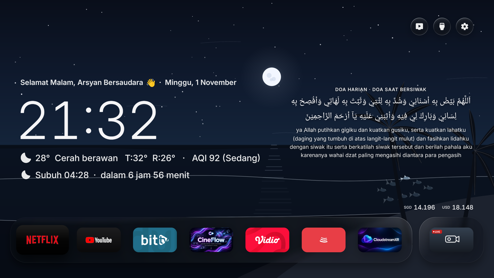
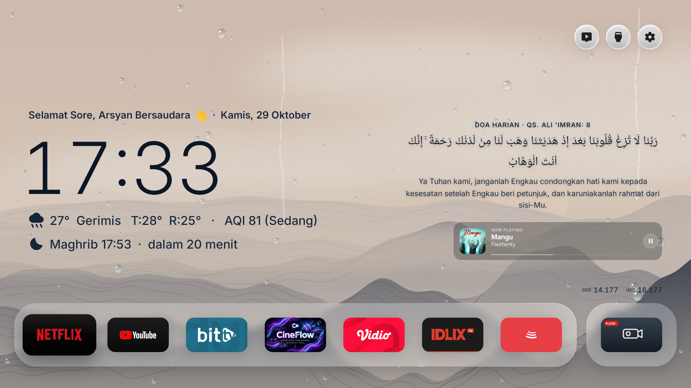
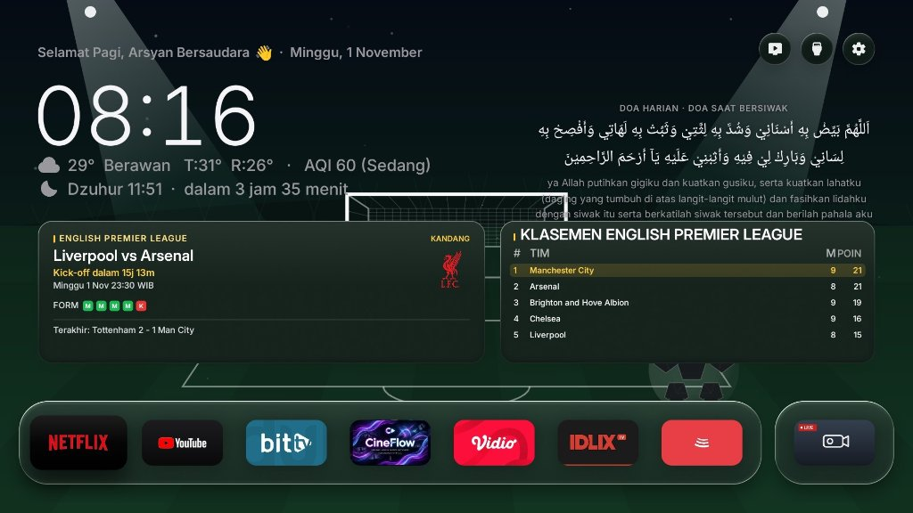
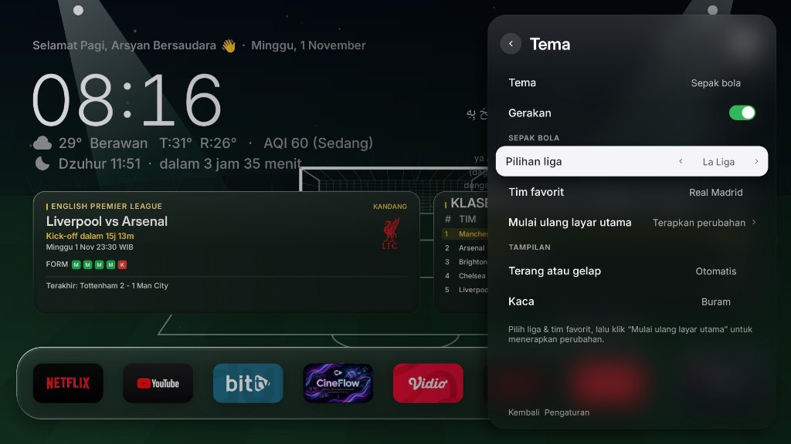
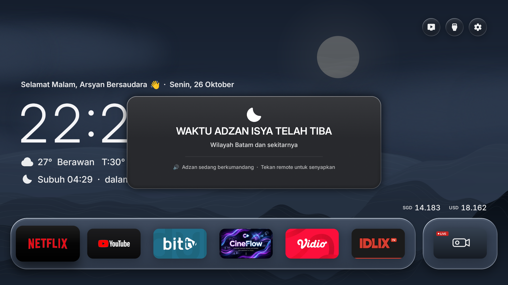
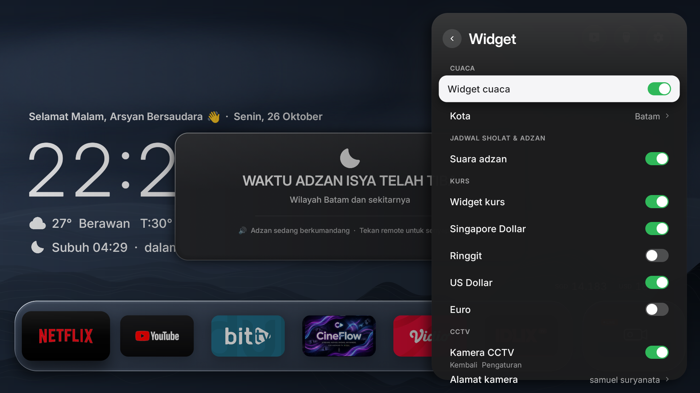

# Arsyan TV Launcher v2.8

[](https://github.com/ssemyy-sds/arsyan-tv-launcher)

<p align="center">
  <a href="README.md">Bahasa</a> · <b>English</b> · <a href="README_MS.md">Malay</a>
</p>

A clean, modern, and aesthetic Android TV launcher inspired by Nothing OS and Apple TV design philosophies. Built natively for Android TV and Google TV devices featuring fluid glassmorphism, clean typography, live dynamic weather, real-time Air Quality Index (AQI), currency exchange rates, dynamic daily prayers and Quranic ayahs, **Live Football / Soccer Theme (Match Schedules & Standings)**, **Now Playing music overlay (BitChord / Spotify / YouTube Music)**, **seamless Over-The-Air (OTA) updates**, and automatic Adzan prayer time notifications. Preconfigured with Kota Batam as default, with full support for any city across Indonesia and worldwide.

---

## 📺 Showcase

### 1. Dynamic Ocean & Coast Vector Wallpaper
A procedural vector coastal and open ocean live wallpaper engine (*Android Canvas*), replacing traditional ink mountains. Features an open ocean horizon, 3 layers of smooth rolling waves (60 FPS), a tranquil coastal coconut palm tree swaying in the sea breeze, and an interactive school of 8 vector fish responding to the TV remote D-Pad. The Sun and Moon rise and set precisely into the ocean horizon following real-time local clock hours, with an anti-overlap safe zone for text.



---

### 2. Minimalist Home Screen with Now Playing Widget
Clean typography layout for the clock, real-time weather, AQI index, prayer countdown, and Daily Prayers (Doa Harian). When music is playing from **BitChord** or other media players, a sleek frosted-glass **Now Playing card** appears seamlessly on the right side above the currency line with album art, track details, artist name, progress bar, and play/pause status.



---

### 3. Live Soccer Theme & Match Widget
Dynamic football-themed wallpaper featuring living pitch grass textures, stadium floodlights, and animated soccer ball visuals. Displays upcoming match fixtures for your favorite club with real-time countdown, club crest, home/away status, recent 5-match form guide, and live top league standings.



---

### 4. League & Favorite Club Customization
Flexible Soccer wallpaper theme settings right inside the TV Settings menu. Choose your favorite club from major worldwide leagues (Premier League, La Liga, Serie A, Bundesliga, Indonesian Liga 1, UEFA Champions League) using your TV remote.



---

### 5. Centered Adzan Notification (~50% Screen)
An elegant, frosted smoked-glass modal banner (~50% screen width) displayed in the center of the screen when prayer time arrives, accompanied by full Adzan audio that can be silenced immediately with any remote button.



---

### 6. Widget & Adzan Sound Settings
Easily toggle Adzan sound on or off directly through the TV settings or within the drawer widget area.



---

## ✨ Features

- **Live Wallpaper "Ocean & Coast" & Astronomical Trajectory (Pure Canvas 60 FPS)**:
  - **100% Programmatic Vector Graphics**: All visual elements (sky, open sea, night stars, coconut palm, rolling waves, rain, fish) are drawn programmatically using native Android Canvas methods (`Path`, `Paint`, `LinearGradient`, `RadialGradient`) without external PNG/JPG textures, ensuring smooth 60 FPS performance without RAM or CPU bloat.
  - **24-Hour Sun & Moon Astronomical Trajectory**:
    - Celestial bodies follow an astronomical curved path (`Math.sin(prog * Math.PI)`) based on real-time local TV time.
    - **Day Cycle (Sun: 05:00 - 19:12)**: Rises from the sea horizon at dawn (05:00), reaches the zenith at midday (12:00), and dips into the ocean at dusk (19:12), casting a warm golden reflection across the water.
    - **Night Cycle (Moon: 19:12 - 05:00)**: Rises in the evening (19:12), peaks at midnight (00:06), and sets before dawn (05:00), casting a shimmering silver corridor onto the sea.
    - **Text Anti-Overlap Safe Zone**: The horizontal trajectory is bounded to the center and center-right sky (X = 50% to 70% of screen width). The left area (X < 46%) containing the greeting, day, date, large clock, and weather/prayer status remains clear with high contrast.
  - **4 Dynamic Sky & Ocean Color Phases**:
    - **Dawn / Sunrise (05:00 - 07:00)**: Soft pink and coral morning gradients with dawn reflections.
    - **Daylight (07:00 - 16:00)**: Bright cyan-blue sky with tropical azure ocean tones.
    - **Golden Sunset (16:00 - 19:12)**: Warm amber, tangerine, and twilight violet gradients.
    - **Starry Night (19:12 - 05:00)**: Deep midnight blue sky with 72 vector stars and a detailed cratered moon.
  - **Weather-Reactive Rain & Storm Overlay**: Desaturates sky and ocean hues into stormy blue-grey tones, accelerates wave rhythms, and renders dual-layer luminous raindrops.
  - **Interactive School of Fish (3D Yaw Turning Physics)**:
    - 8 vector fish glide gracefully through ocean depths with harmonic tail-wagging physics.
    - **D-Pad Remote Response**: Fish turn toward the direction pressed on the TV remote (Left, Right, Up, Down).
    - **3D Perspective Yaw Turn**: When changing to the opposite direction, the fish execute a natural lateral 3D yaw turn (gradual body-width shrinkage and flip) with cascading delay from leader to followers, avoiding abrupt U-turn pivots.
- **"Buy Developer a Coffee" Donation Feature**:
  - Dedicated button located in **Settings -> About** directly beneath the OTA update button.
  - Opens an elegant modal popup showing a static QR code and a heartfelt message of gratitude from the developer, with easy remote control dismissal.
- **Exclusive Focus on Android TV**:
  - Engineered natively for Android TV and Google TV (API 28+ / Android 9 to Android 14+).
  - Native Android `Canvas` rendering pipeline without heavy WebView or hybrid framework overhead (solid 60 FPS).
- **Interactive Live Football / Soccer Theme**:
  - Dynamic grass-pitch wallpaper with realistic floodlight beams, goalposts, and animated soccer ball visuals.
  - **Favorite Club Match Card**: Displays upcoming fixtures with live countdowns, home/away status, team badges, and 5-match form history.
  - **Live League Standings**: Top 5 standings table updated automatically from live football APIs.
  - **Supports Popular Leagues**: English Premier League, Spanish La Liga, Italian Serie A, German Bundesliga, Indonesian Liga 1, and UEFA Champions League.
- **Now Playing Music Widget (BitChord & Universal Media)**:
  - Automatically captures active playback metadata from **BitChord** (`com.music.bitchord.tv`), Spotify, YouTube Music, and other media apps via native Android `MediaSession`.
  - Displays high-resolution rounded album cover art, song title, artist, progress line, and live play/pause indicator.
  - Positioned symmetrically on the right side above currency rates.
  - **Smart Visibility**: Automatically appears when music is playing or paused, and cleanly auto-hides when music stops to keep the home screen minimalist.
- **Over-The-Air (OTA) Updates via GitHub Releases**:
  - Direct in-app update mechanism powered by GitHub Releases API (`ssemyy-sds/arsyan-tv-launcher`).
  - Automatic background update checks with ambient notification banners when new versions are available.
  - Manual check & install directly from **Settings → About (System Update / OTA)**.
  - Features real-time download progress and seamless installation without requiring a computer or ADB connection for future updates.
- **Dynamic Daily Prayer & Quranic Ayahs from GitHub Raw**:
  - Sourced from **71 authentic daily prayers and Quranic ayahs** dynamically via GitHub Raw CDN (`iherbs/quran-json`).
  - **Offline-First Architecture**: Caches prayers locally so the home screen always renders instantaneously (0ms latency) even without an internet connection.
  - **Accurate Local Time Rotation**: Automatically advances to the next prayer at 00:00 local TV midnight (`Calendar.DAY_OF_YEAR`), eliminating UTC timezone offset delays.
- **Air Quality Index (AQI) - Batam Default & Worldwide**:
  - Live Air Quality data integration via Open-Meteo Air Quality API.
  - Displays US AQI values and qualitative categories (`Good`, `Moderate`, `Sensitive`, `Unhealthy`, etc.) directly alongside the weather line.
  - Automatically queries the coordinates of your chosen city.
- **Prayer Times & Adzan (Batam Default, Customizable Worldwide)**:
  - Automatically calculates the five daily prayer times (Fajr, Dhuhr, Asr, Maghrib, Isha) using accurate astronomical solar positioning following Kemenag RI standards (Fajr 20°, Isha 18°, Shafi'i Asr, +2-3 min ihtiyat).
  - Preconfigured for Kota Batam (`1.1301° N, 104.0529° E`), but fully supports any city across Indonesia or worldwide by setting your city in **Settings → Home Settings → City**.
  - Next prayer countdown displayed directly on the home screen.
  - Background alarm scheduling (`AlarmManager.RTC_WAKEUP`) ensures timely alerts even if the launcher is in the background or sleeping.
  - **Smart Audio Focus Management**: Automatically pauses background media apps (YouTube, Spotify, video players) during the Adzan call, and seamlessly resumes playback once dismissed.
  - **Floating Banner Overlay**: Powered by a dedicated foreground service (`AdzanService`) to display a sleek frosted-glass alert banner on top of other running apps without stealing remote control focus.
  - Full Adzan audio playback with one-click silence using any remote control key.
- **Weather & Exchange Rates**:
  - Open-Meteo integration for accurate temperature, conditions, and daily high/low.
  - Real-time SGD and USD currency exchange rates.
- **Clean Typography UI**:
  - Delivers a minimalist typographic aesthetic without chunky opaque card containers obscuring the wallpaper.
- **Smooth Animations & Hardware Efficiency**:
  - Highly optimized for entry-level TV sticks up to high-end Android TV and Google TV sets (ZTE, Mi Box, TCL, Sony, etc.).

---

## 🌍 City & Regional Customization

By default, Arsyan TV is preconfigured for **Kota Batam**. However, it fully supports **any city in Indonesia and worldwide**:

1. Open **Settings** (gear icon in the app drawer).
2. Navigate to **Home Settings → City**.
3. Type your city name (e.g., `Jakarta`, `Surabaya`, `Bandung`, `London`, `Tokyo`, etc.).
4. Select your city from the search results.
5. **Prayer Times & Adzan, Weather Forecasts, and Air Quality (AQI)** will instantly calibrate to your selected city's exact coordinates.

---

## 🛠️ Building & Installing

### Prerequisites
- JDK 17+ or JDK 21+ (compatible with modern JDKs, including JDK 26)
- Android SDK (`build-tools 35.0.0` or `34.0.0`, `platforms/android-34`)
- ADB tools for connecting to Android TV

### Build APK
Run the build script:
```bash
bash ./build.sh
```
This compiles the project and generates **`ArsyanTV.apk`** in the root directory.

### Install to Android TV
1. Enable **Developer Options** and **Network Debugging / USB Debugging** on your Android TV.
2. Connect to your TV over ADB:
   ```bash
   adb connect <TV_IP_ADDRESS>:5555
   ```
3. Install the APK:
   ```bash
   adb -s <TV_IP_ADDRESS>:5555 install -r ArsyanTV.apk
   ```
4. Grant the display overlay permission (for the Adzan notification banner over other apps):
   ```bash
   adb -s <TV_IP_ADDRESS>:5555 shell appops set io.freemytv SYSTEM_ALERT_WINDOW allow
   ```
5. Grant notification listener permission (for the Now Playing music card):
   ```bash
   adb -s <TV_IP_ADDRESS>:5555 shell cmd notification allow_listener io.freemytv/.NowPlayingService
   ```

> [!TIP]
> **Subsequent Updates (OTA):** Once Arsyan TV is installed, you no longer need to use ADB or a laptop for future updates! Simply publish a new release on GitHub, and your TV will detect and install the update wirelessly via **Settings → About → System Update (OTA)**.

---

## 🙏 Credits & Acknowledgments

This project is built upon the wonderful work of the open-source community:

- **[Free My TV](https://github.com/simbasjungles/free-my-tv)** by [simbasjungles](https://github.com/simbasjungles) – Foundational open-source Android TV launcher codebase and architecture.
- **[WeatherGlass TV](https://github.com/faizaldjoo/weatherglass-tv)** by [faizaldjoo](https://github.com/faizaldjoo) – Islamic prayer calculations and weather glass UI inspiration.
- **[BitChord](https://github.com/kushagrasinghx/BitChord)** by [kushagrasinghx](https://github.com/kushagrasinghx) – Open-source music client for Android TV.
- **[quran-json](https://github.com/iherbs/quran-json)** by [iherbs](https://github.com/iherbs) – Curated daily prayer and Quranic dataset.
- Modified and maintained by **semy** (Arsyan TV).

---

## 📄 License

This repository is distributed under the MIT License. See [LICENSE](LICENSE) for details.

