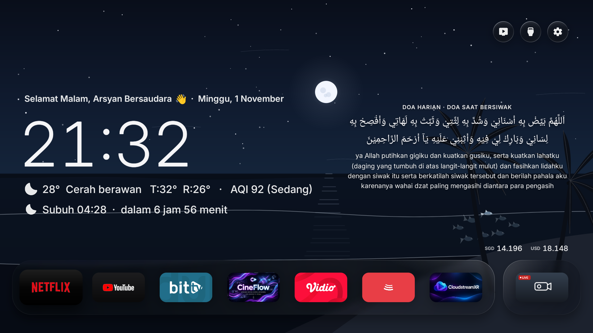
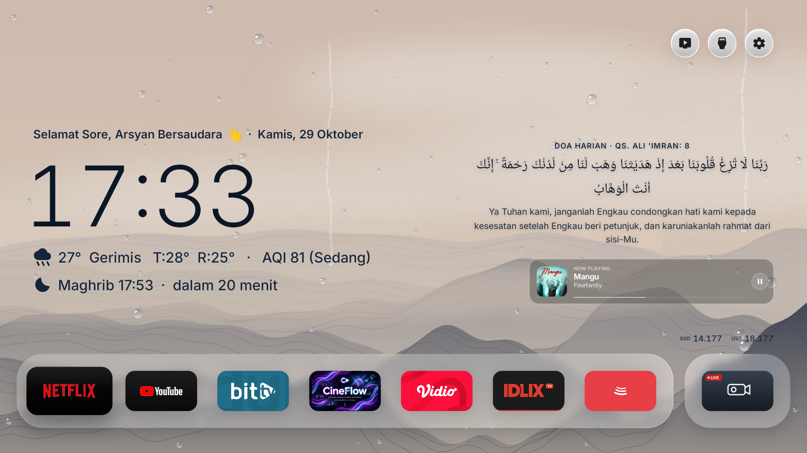
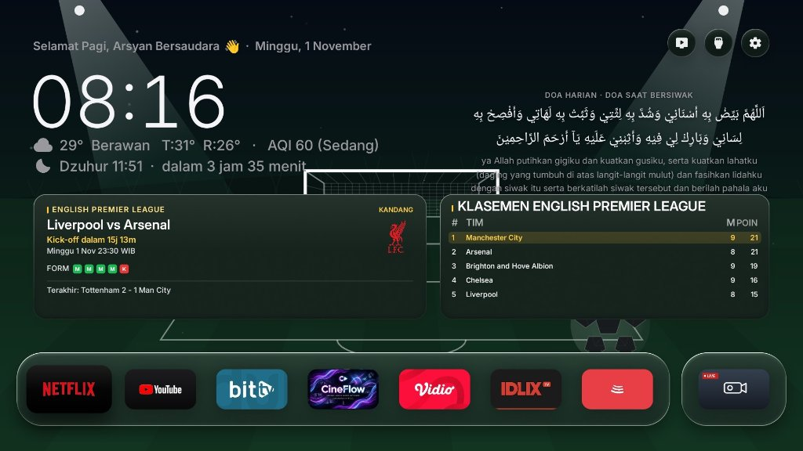
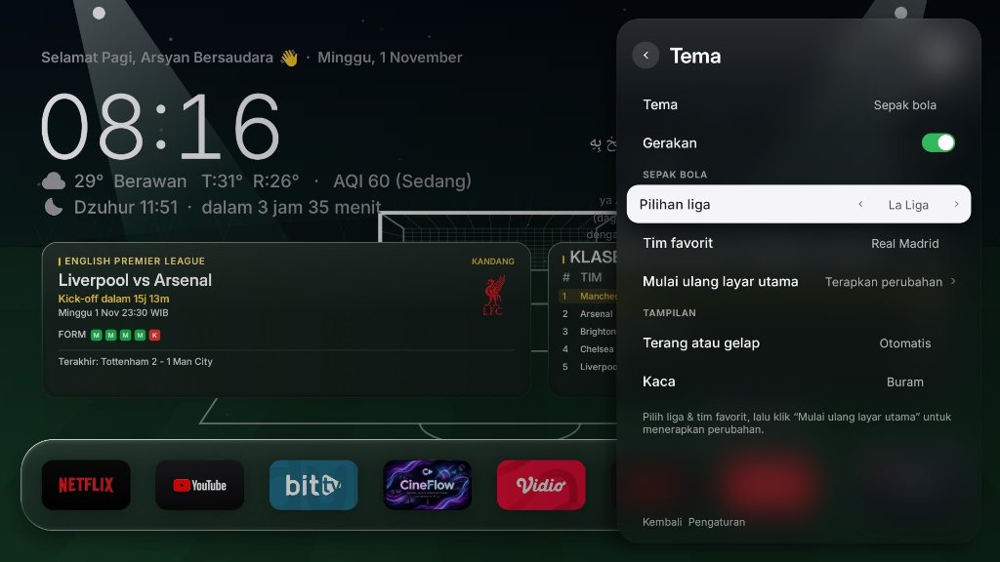
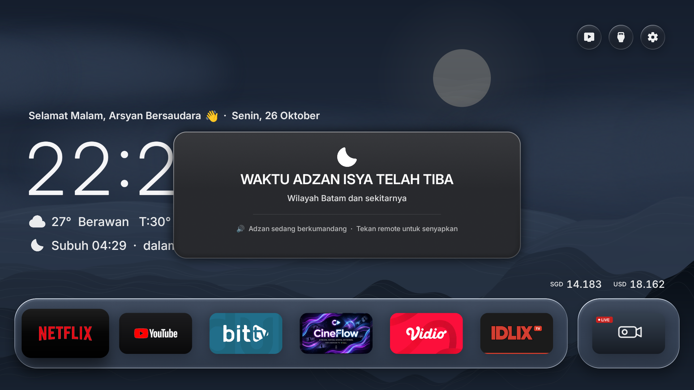
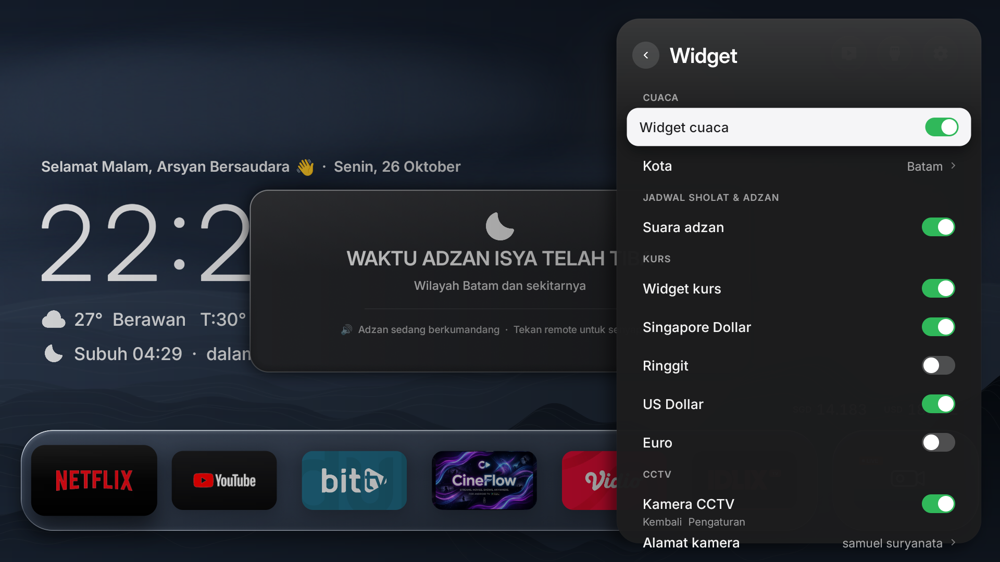

# Arsyan TV Launcher v2.8

[](https://github.com/ssemyy-sds/arsyan-tv-launcher)

<p align="center">
  <a href="README.md">Bahasa</a> · <a href="README_EN.md">English</a> · <b>Malay</b>
</p>

Pelancar (*Launcher*) Android TV yang kemas, moden dan estetik berinspirasikan falsafah reka bentuk Nothing OS dan Apple TV. Dibangunkan secara natif untuk peranti Android TV dan Google TV dengan sentuhan *glassmorphism* lembut, tipografi elegan, ramalan cuaca langsung waktu nyata, Indeks Kualiti Udara (AQI), kadar pertukaran mata wang, doa harian dan ayat Al-Quran dinamik, **Tema Bola Sepak Langsung (Jadual Perlawanan & Kedudukan Liga)**, **Lapisan Muzik Now Playing (BitChord / Spotify / YouTube Music)**, **Kemas Kini Nirkabel Tanpa Wayar (OTA)** terus melalui GitHub Releases, serta pemberitahuan waktu solat dan Azan automatik. Dikonfigurasikan secara lalai untuk Kota Batam dengan sokongan penuh untuk semua bandar di Malaysia, Indonesia dan seluruh dunia.

---

## 📺 Pratonton (Showcase)

### 1. Kertas Dinding Vektor Dinamik "Ocean & Coast" (Tema Pantai & Laut Luas)
Pengganti penuh kertas dinding langsung pergunungan dengan tema pesisir pantai vektor tulen (*Android Canvas*). Menampilkan ufuk laut terbentang luas, 3 lapisan ombak bergulung lembut (60 FPS), pokok kelapa tenang ditiup bayu laut, serta kawanan 8 ekor ikan vektor interaktif yang berenang mengikut butang kawalan jauh D-Pad TV. Kedudukan Matahari dan Bulan terbit dan terbenam tepat ke garis ufuk laut mengikut waktu jam tempatan dengan zon selamat bebas pertembungan teks.



---

### 2. Paparan Utama Minimalis dengan Widget Now Playing
Susun atur tipografi kemas untuk jam besar, cuaca masa nyata, indeks AQI, pengiraan detik waktu solat, dan Doa Harian. Apabila lagu dimainkan daripada **BitChord** atau pemain media lain, kad kaca kabur (*frosted-glass*) **Now Playing** akan dipaparkan secara lancar di sebelah kanan atas kadar mata wang, lengkap dengan kulit album, tajuk lagu, nama artis, bar kemajuan, dan status main/jeda.



---

### 3. Tema Bola Sepak & Widget Perlawanan Langsung
Kertas dinding dinamik bertemakan padang bola sepak dengan tekstur rumput hidup dan pencahayaan lampu limpah stadium (*stadium floodlights*). Memaparkan jadual perlawanan terkini kelab kegemaran lengkap dengan pengiraan detik waktu sepak mula, logo kelab, status perlawanan (Laman Sendiri / Tempat Lawan), rekod 5 perlawanan terakhir, serta jadual kedudukan terkini liga secara langsung.



---

### 4. Tetapan Pilihan Liga & Kelab Kegemaran
Pilihan tema kertas dinding Bola Sepak yang fleksibel terus daripada menu Tetapan TV. Pilih liga utama dunia (Premier League, La Liga, Serie A, Bundesliga, Liga Super Malaysia, Liga 1 Indonesia, UEFA Champions League) bersama kelab pilihan anda hanya menggunakan alat kawalan jauh TV.



---

### 5. Pemberitahuan Azan Berpusat (~50% Skrin)
Paparan modal kad kaca gelap yang elegan (~50% lebar skrin) di bahagian tengah skrin apabila masuk waktu solat, diiringi laungan audio Azan penuh yang boleh disenyapkan serta-merta dengan menekan sebarang butang alat kawalan jauh.



---

### 6. Tetapan Widget & Bunyi Azan
Kawalan mudah untuk mengaktifkan atau mematikan bunyi Azan secara langsung melalui menu Tetapan TV atau di dalam laci widget.



---

## ✨ Ciri-Ciri Utama

- **Kertas Dinding Langsung "Ocean & Coast" & Peredaran Astronomi Dinamik (Pure Canvas 60 FPS)**:
  - **Vektor Programatik Penuh**: Keseluruhan elemen visual (langit, laut luas, bintang malam, pokok kelapa, ombak, hujan, ikan) dilukis secara natif menggunakan kaedah Canvas Android (`Path`, `Paint`, `LinearGradient`, `RadialGradient`) tanpa fail imej luaran PNG/JPG, memberikan prestasi ultra-lancar 60 FPS tanpa membebankan memori RAM atau pemproses TV.
  - **Peredaran 24 Jam Matahari & Bulan (Real-Time Astronomical Trajectory)**:
    - Kedudukan objek langit bergerak mengikut lengkungan matematik (`Math.sin(prog * Math.PI)`) berasaskan waktu jam tempatan TV.
    - **Kitaran Siang (Matahari: 05:00 - 19:12)**: Terbit di ufuk laut semasa fajar (05:00), mencapai titik zenit pada tengah hari (12:00), dan terbenam ke laut pada waktu senja (19:12) memancarkan jalur kilauan keemasan di permukaan air.
    - **Kitaran Malam (Bulan: 19:12 - 05:00)**: Terbit pada awal malam (19:12), mencapai kemuncak pada tengah malam (00:06), dan terbenam sebelum subuh (05:00) menghasilkan pantulan cahaya perak di lautan.
    - **Zon Selamat Bebas Pertembungan Teks (Anti-Overlap Safe Zone)**: Laluan objek langit dihadkan secara tepat pada kawasan tengah dan tengah-kanan langit (X = 50% hingga 70% lebar skrin). Kawasan kiri (X < 46%) yang memaparkan teks ucapan, hari, tarikh, jam besar dan status cuaca/solat sentiasa kekal jelas dengan kontras gelap.
  - **4 Fasa Warna Langit & Laut Dinamik**:
    - **Fajar / Sunrise (05:00 - 07:00)**: Gradasi langit merah jambu lembut dan pantulan pagi di permukaan laut.
    - **Siang / Daylight (07:00 - 16:00)**: Langit biru cerah dengan warna laut biru firus tropika.
    - **Senja / Golden Sunset (16:00 - 19:12)**: Gradasi warna jingga hangat, amber dan ungu senja.
    - **Malam / Starry Night (19:12 - 05:00)**: Langit biru pekat berbintang (72 bintang vektor rawak stabil) bersama bulan berkawah bercahaya.
  - **Lapisan Cuaca Hujan & Ribut**: Mengurangkan kepekatan warna (*desaturate*) langit dan laut menjadi kelabu kebiruan apabila cuaca hujan, ombak beralun lebih deras, serta titisan hujan kristal bercahaya 2 lapisan.
  - **Kawanan Ikan Interaktif (Fizik Pusingan Lateral 3D Yaw)**:
    - 8 ekor ikan vektor berenang anggun di dasar laut dengan animasi hayunan ekor semula jadi.
    - **Respons D-Pad Alat Kawalan Jauh**: Kawanan ikan menukar arah mengikut butang navigasi remote (Kiri, Kanan, Atas, Bawah).
    - **Pusingan Perspektif 3D Yaw**: Apabila menukar arah bertentangan, ikan tidak berpusing secara kaku, sebaliknya melakukan pusingan lateral 3D (kelebaran badan mengecut dan membalik secara lembut) dengan tindak balas berperingkat (*cascading delay*) dari ketua kawanan kepada pengikut.
- **Ciri Sokongan "Belanja Kopi" (Support Developer)**:
  - Butang khusus di menu **Tetapan -> Perihal** (*Settings -> About*) betul-betul di bawah butang kemas kini OTA.
  - Memaparkan tetingkap dialog modal dengan kod QR statik dan ucapan terima kasih tulus daripada pembangun untuk belanja secawan kopi.
- **Fokus Eksklusif pada Android TV**:
  - Dicipta secara natif untuk peranti Android TV & Google TV (API 28+ / Android 9 hingga Android 14+).
  - Enjin lukisan natif Android `Canvas` tanpa bebanan WebView atau rangka kerja hibrid yang berat (stabil 60 FPS).
- **Tema Bola Sepak Interaktif (Jadual & Kedudukan Liga Terkini)**:
  - Kertas dinding padang bola dinamik dengan kesan pencahayaan lampu limpah stadium dan animasi bola sepak.
  - **Kad Perlawanan Pasukan Pilihan**: Memaparkan jadual perlawanan akan datang dengan pengiraan detik masa nyata, venue gelanggang, lencana kelab, dan rekod 5 perlawanan terdahulu.
  - **Jadual Kedudukan Liga**: Kedudukan 5 teratas liga yang dikemas kini secara automatik daripada API bola sepak langsung.
  - **Sokongan Pelbagai Liga Utama**: English Premier League, La Liga Sepanyol, Serie A Itali, Bundesliga Jerman, Liga Super / Liga 1, dan UEFA Champions League.
- **Widget Muzik Now Playing (BitChord & Media Universal)**:
  - Mengesan status main balik dan metadata secara automatik daripada **BitChord** (`com.music.bitchord.tv`), Spotify, YouTube Music dan aplikasi media Android lain melalui `MediaSession` natif.
  - Memaparkan seni album beresolusi tinggi, tajuk lagu, artis, bar kemajuan lagu, serta status main/jeda.
  - Ditempatkan secara kemas di sebelah kanan atas maklumat kadar mata wang.
  - **Penglihatan Pintar**: Muncul secara automatik apabila muzik dimainkan atau dijeda, dan tersembunyi sendiri apabila muzik dihentikan.
- **Kemas Kini Nirkabel / Over-The-Air (OTA) via GitHub Releases**:
  - Sistem kemas kini terus dari dalam aplikasi memanfaatkan GitHub Releases API (`ssemyy-sds/arsyan-tv-launcher`).
  - Semakan latar belakang automatik dengan sepanduk pemberitahuan apabila versi baharu diterbitkan.
  - Pilihan semakan dan pemasangan manual dari menu **Tetapan → Perihal (Kemas Kini Sistem / OTA)**.
  - Paparan kemajuan muat turun secara langsung tanpa memerlukan komputer atau sambungan ADB untuk kemas kini masa depan.
- **Doa Harian & Ayat Al-Quran Dinamik dari GitHub Raw**:
  - Memuatkan **71 doa harian sahih dan ayat Al-Quran** terus dari GitHub Raw CDN (`iherbs/quran-json`).
  - **Seni Bina Luar Talian (Offline-First)**: Disimpan dalam memori peranti supaya skrin utama dibuka serta-merta tanpa sebarang kelengahan walaupun ketiadaan internet.
  - **Pertukaran Mengikut Waktu Tempatan**: Berubah kepada doa seterusnya tepat jam 00:00 tengah malam waktu tempatan TV (`Calendar.DAY_OF_YEAR`).
- **Indeks Kualiti Udara (AQI) - Batam Default & Seluruh Dunia**:
  - Integrasi bacaan kualiti udara masa nyata menerusi Open-Meteo Air Quality API.
  - Memaparkan nilai US AQI dan kategori kualiti udara (`Baik`, `Sederhana`, `Sensitif`, `Tidak Sihat`, dsb.) bersebelahan baris maklumat cuaca.
  - Mengambil koordinat lokasi bandar anda secara automatik.
- **Waktu Solat & Azan (Default Batam, Boleh Ditetapkan ke Mana-mana Bandar)**:
  - Pengiraan automatik 5 waktu solat fardhu (Subuh, Zohor, Asar, Maghrib, Isyak) mengikut hisab kedudukan matahari astronomi tepat (Subuh 20°, Isyak 18°, Asar Syafi'i, +2-3 minit waktu ihtiyat).
  - Ditetapkan secara lalai untuk Kota Batam (`1.1301° N, 104.0529° E`), namun menyokong penuh semua bandar di Malaysia (Kuala Lumpur, Johor Bahru, Pulau Pinang, Kuching, Kota Kinabalu, dsb.), Indonesia, mahupun antarabangsa melalui menu **Tetapan → Tetapan Skrin Utama → Bandar**.
  - Pengiraan detik waktu solat seterusnya dipaparkan di skrin utama.
  - Penggera latar belakang (`AlarmManager.RTC_WAKEUP`) memastikan pemberitahuan tepat pada masanya walaupun pelancar berada di latar belakang atau TV dalam mod siap sedia (*standby*).
  - **Kawalan Audio Pintar**: Menjeda sementara aplikasi media yang sedang berbunyi (YouTube, Spotify, pemain video) semasa laungan Azan, dan menyambung semula lagu secara automatik selepas azan tamat.
  - **Sepanduk Terapung (Floating Overlay)**: Dikuasakan oleh perkhidmatan latar hadapan (`AdzanService`) untuk memaparkan sepanduk kaca di atas aplikasi lain yang sedang dibuka tanpa mengganggu fungsi alat kawalan jauh.
  - Laungan audio Azan lengkap dengan fungsi hening serta-merta melalui sebarang butang remote.
- **Cuaca & Kadar Pertukaran Mata Wang**:
  - Integrasi Open-Meteo untuk bacaan suhu tepat, keadaan cuaca semasa, dan julat suhu harian.
  - Kadar pertukaran langsung mata wang SGD dan USD.
- **Antara Muka Tipografi Minimalis**:
  - Mengekalkan estetika tipografi bersih tanpa kotak tebal legap yang menghalang keindahan gambar latar.
- **Animasi Lancar & Kecekapan Perkakasan**:
  - Dioptimumkan khusus untuk semua jenis peranti Android TV dan Google TV dari peringkat permulaan hingga model premium.

---

## 🌍 Penyesuaian Bandar & Wilayah

Secara lalai, Arsyan TV ditetapkan untuk **Kota Batam**. Walau bagaimanapun, pelancar ini menyokong sepenuhnya **semua bandar di Malaysia, Indonesia dan antarabangsa**:

1. Buka **Tetapan** (ikon gear dalam laci aplikasi).
2. Pergi ke menu **Tetapan Skrin Utama → Bandar**.
3. Taip nama bandar anda (contoh: `Kuala Lumpur`, `Johor Bahru`, `Pulau Pinang`, `Jakarta`, `Singapura`, dll.).
4. Pilih bandar daripada senarai carian.
5. **Waktu Solat & Azan, Ramalan Cuaca, serta Indeks Kualiti Udara (AQI)** akan dikalibrasi secara automatik mengikut koordinat tepat bandar pilihan anda.

---

## 🛠️ Membina & Memasang

### Keperluan Asas
- JDK 17+ atau JDK 21+ (serasi dengan JDK moden termasuk JDK 26)
- Android SDK (`build-tools 35.0.0` atau `34.0.0`, `platforms/android-34`)
- Alat ADB untuk sambungan ke Android TV

### Membina APK
Jalankan skrip binaan:
```bash
bash ./build.sh
```
Skrip ini akan menyusun kod dan menghasilkan fail **`ArsyanTV.apk`** di direktori utama.

### Memasang ke Android TV
1. Aktifkan **Pilihan Pembangun (Developer Options)** dan **Penyahpepijatan Rangkaian / USB (Debugging)** pada Android TV anda.
2. Sambungkan TV melalui ADB:
   ```bash
   adb connect <ALAMAT_IP_TV>:5555
   ```
3. Pasang fail APK:
   ```bash
   adb -s <ALAMAT_IP_TV>:5555 install -r ArsyanTV.apk
   ```
4. Berikan kebenaran paparan sepanduk (*display overlay*):
   ```bash
   adb -s <ALAMAT_IP_TV>:5555 shell appops set io.freemytv SYSTEM_ALERT_WINDOW allow
   ```
5. Berikan kebenaran pendengar notifikasi (untuk kad muzik Now Playing):
   ```bash
   adb -s <ALAMAT_IP_TV>:5555 shell cmd notification allow_listener io.freemytv/.NowPlayingService
   ```

> [!TIP]
> **Kemas Kini Seterusnya (OTA):** Selepas Arsyan TV dipasang, anda tidak perlu lagi menggunakan ADB atau komputer untuk kemas kini akan datang! Cukup dengan memuat naik versi baharu di GitHub, TV anda akan mengesan dan memasang kemas kini secara terus melalui menu **Tetapan → Perihal → Kemas Kini Sistem (OTA)**.

---

## 🙏 Penghargaan & Kredit

Projek ini dibangunkan berasaskan sumbangan komuniti sumber terbuka:

- **[Free My TV](https://github.com/simbasjungles/free-my-tv)** oleh [simbasjungles](https://github.com/simbasjungles) – Asas seni bina reka bentuk pelancar Android TV sumber terbuka.
- **[WeatherGlass TV](https://github.com/faizaldjoo/weatherglass-tv)** oleh [faizaldjoo](https://github.com/faizaldjoo) – Pengiraan waktu solat dan inspirasi antara muka cuaca.
- **[BitChord](https://github.com/kushagrasinghx/BitChord)** oleh [kushagrasinghx](https://github.com/kushagrasinghx) – Pemain muzik sumber terbuka Android TV.
- **[quran-json](https://github.com/iherbs/quran-json)** oleh [iherbs](https://github.com/iherbs) – Pangkalan data doa harian.
- Diubah suai dan diselenggara oleh **semy** (Arsyan TV).

---

## 📄 Lesen

Repositori ini diedarkan di bawah Lesen MIT. Sila rujuk fail [LICENSE](LICENSE) untuk maklumat lanjut.

